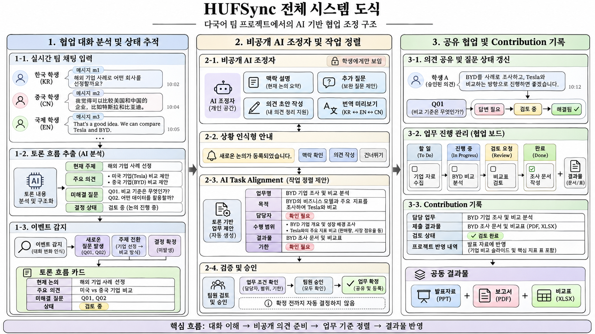

# HUFSync · 훕싱크

### 한국외대 내·외국인 학생을 위한 AI 협업 조정 플랫폼

**대화의 맥락을 이해하고, 자기 언어로 의견을 준비하며, 함께 정한 업무를 공동의 결과물로 연결합니다.**

한국외국어대학교 **2026 AI 캠퍼스: 바이브코딩 경진대회**를 위해 발전시킨 팀 프로젝트의 기획·시스템 설계 포트폴리오입니다. HUFSync는 HUFS와 서로의 흐름을 맞춘다는 의미의 Sync를 결합한 이름입니다.

| 항목 | 내용 |
| --- | --- |
| 팀 | 알파메일 · 4인 팀 프로젝트 |
| 소속 | 한국외국어대학교 Social Science & AI |
| 포트폴리오 기록 | 송진우 |
| 현재 기록 단계 | 기획 및 시스템 설계 · 2026-11-11 기준 |
| 초기 대상 | 한국어·영어·중국어를 사용하는 내·외국인 혼합 팀 |
| 공개 자료 | 기획서 공개본, 시스템 인포그래픽, 설계 변화, 개발·검증 계획 |

현재 저장소에는 기획 문서와 설계 자료를 담았습니다. 서비스 코드·배포·사용자 테스트 결과와 대회 선정·수상 결과는 확인되는 시점에 별도로 기록합니다.

## 시스템 한눈에 보기

사용자 제공 인포그래픽 원본입니다. **구현 예정 흐름을 설명하는 설계도**이며, 작동 중인 서비스의 화면 캡처는 아닙니다. 이미지를 누르면 원본 크기로 볼 수 있습니다.

## 어떤 문제에서 출발했나요?

중국인 유학생과 함께한 팀플에서, 빠른 한국어 논의를 번역하고 답변을 준비하는 동안 의견을 낼 시점을 놓치는 경험에 주목했습니다. 서로의 부담을 줄이려 독립적인 업무를 나눴지만, 조사 범위와 결과물 기준을 충분히 맞추지 못해 취합 단계에서 수정이 필요했습니다.

HUFSync는 **논의를 이해하는 문제**와 **같은 업무 기준을 공유하는 문제**를 연결해 다룹니다. 진행 중인 쟁점을 함께 보고, 개인 공간에서 의견을 준비하고, 확정된 결정과 업무·결과물의 연결을 남기도록 설계했습니다.

## 핵심 설계

| 영역 | 제공하려는 기능 | 설계의 초점 |
| --- | --- | --- |
| AI 토론 흐름 카드 | 현재 주제·주요 의견·미해결 질문·결정 상태와 근거 메시지 | 지금 무엇을 논의하는지 공통으로 이해 |
| 비공개 AI 조정자 | 맥락 설명, 추가 질문, 모국어 초안, 번역 미리보기 | 본인이 확인한 의견만 공유 |
| AI Task Alignment | 업무 목적·담당자·범위·결과물·기한 정리, 누락 조건 확인 | 작업 전에 수행 기준을 맞춤 |
| 협업 진행·Contribution 기록 | 업무 상태, 자료 링크, 검토·반영 내역 요약 | 실제 작업과 공동 결과물의 연결을 확인 |

**핵심 흐름:** 다국어 대화 → 논의 상태 확인 → 비공개 의견 준비 → 팀의 결정 → 업무 조건 확인 → 결과물 공유·검토

## 포트폴리오 문서

| 문서 | 내용 |
| --- | --- |
| [기획안 정리](docs/proposal.md) | 경험·문제 정의·서비스 기능·차별화 방향 |
| [기획서 PDF 공개본](docs/submission/hufsync-proposal-public.pdf) | 개인정보 표와 동의서를 제외한 기획 본문 |
| [시스템 아키텍처](docs/architecture.md) | 모듈·데이터 연결·AI 처리·공개 범위 설계 |
| [대표 사용자 시나리오](docs/user-scenario.md) | BYD·Tesla 비교 토론에서 업무와 결과물까지 이어지는 예시 |
| [설계 변화와 피드백 반영](docs/design-evolution.md) | 초기 발언 점수 구상에서 논의·업무 중심 설계로 바뀐 이유 |
| [개발·검증 계획](docs/roadmap-and-validation.md) | 본선 진출 시 3주 일정, MVP 범위, 파일럿 계획 |
| [근거 및 참고자료](docs/references.md) | 공식 학교 통계, 논문, 대회 공지와 출처 확인 범위 |
| [공개 자료 안내](docs/submission/README.md) | 원문·공개본의 관계와 자료 보관 범위 |

## 설계에서 중요하게 본 판단

- **사람의 발언에 점수를 매기기보다 논의 상태를 추적합니다.** 새로운 질문·주제의 발생을 안내하고, 알림은 사용자가 선택하도록 설계했습니다.
- **AI 결과에 근거를 연결합니다.** 메시지 ID를 검증하고, 원문에서 확인되지 않은 업무 조건은 ‘확인 필요’로 남깁니다.
- **결정과 업무 배정은 팀이 확인합니다.** AI는 카드 초안을 제안하고, 팀원이 조건을 검토한 뒤 확정합니다.
- **개인 준비 공간과 공유 기록을 구분합니다.** 개인 질문·초안은 작성자만 접근하고, 본인이 승인한 내용이 팀에 전달됩니다.
- **Contribution은 작업 기록입니다.** 등록된 자료·검토·반영 내역을 정리하는 구상이며 개인별 자동 기여도 점수나 순위가 아닙니다.

## 기술 검토 방향

기획서에서는 Next.js, Supabase, 생성형 AI API, Vercel을 검토했습니다. HyperCLOVA X를 우선 후보로 두고 한·영·중 처리 품질, 이용 가능 여부와 비용을 확인한 뒤 단일 API 중심으로 MVP를 구성할 계획입니다. API 호출·접근 권한·정확성은 이후 구현과 검증에서 확인할 항목입니다.

이후 실제 개발이 진행되면 이 저장소에 코드와 실행 방법, 구현 상태, 검증 결과, 변경 기록을 연결합니다.
