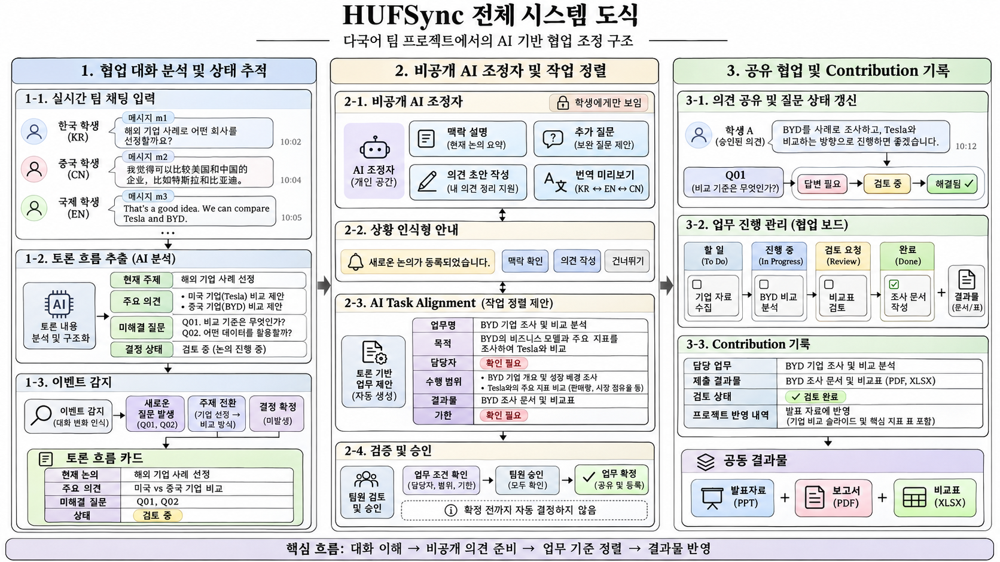
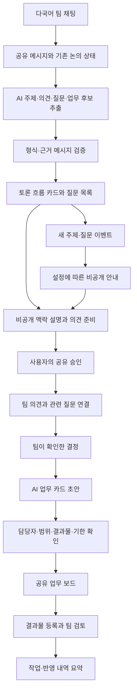

# HUFSync 시스템 아키텍처

이 문서는 제공된 기획안과 인포그래픽을 설명하는 **구현 전 설계안**입니다. 데이터 모델과 처리 흐름은 검토 대상으로, 배포된 시스템이나 검증된 권한 정책을 뜻하지 않습니다.

## 1. 세 영역의 연결

| 인포그래픽 영역 | 구성 | 연결되는 기록 |
| --- | --- | --- |
| 협업 대화 분석 및 상태 추적 | 다국어 채팅, 논의 분석, 새 질문·주제 변화 감지, 토론 흐름 카드 | 메시지 → 질문 → 결정 |
| 비공개 AI 조정자 및 작업 정렬 | 개인 설명·질문·초안·번역, 선택형 안내, 업무 카드 초안·조건 확인 | 개인 초안 → 승인된 의견 / 결정 → 업무 |
| 공유 협업 및 Contribution 기록 | 질문 검토·해결, 업무 보드, 결과물·검토·반영 기록 | 업무 → 결과물 → 공동 결과물 반영 |

## 2. 검토 중인 기술 구성

| 계층 | 검토 기술 | 맡길 역할 |
| --- | --- | --- |
| 웹 화면 | Next.js | 채팅, 토론 카드, 개인 AI 패널, 업무 카드·보드 |
| 인증·저장·동기화 | Supabase | 사용자·팀, 메시지·질문·업무, 실시간 갱신, 접근 권한 |
| AI | 생성형 AI API · HyperCLOVA X 우선 검토 | 번역, 대화 상태·업무 추출, 맥락 설명, 기록 요약 |
| 배포 | Vercel | 브라우저로 접근하는 반응형 웹앱 |

초기에는 단일 AI API를 중심으로 품질과 비용을 확인합니다. 분석을 매 메시지마다 실행하기보다 일정량의 대화 누적이나 사용자 갱신 요청 시 최근 대화와 기존 상태를 함께 전달하는 방향입니다.

## 3. 데이터 연결 설계

아래는 기능을 설명하기 위한 개념 모델이며, 확정된 DB 스키마는 아닙니다.

| 기록 | 핵심 필드 | 연결 |
| --- | --- | --- |
| Message | ID, 팀·채팅방, 작성자, 원문, 시간 | 분석·질문·의견의 원문 근거 |
| DiscussionState | 주제, 주요 의견, 미해결 질문, 상태, 근거 ID | 이전 분석과 비교 |
| Question | 고유 ID, 질문, 상태, 관련 메시지 | 의견과 최종 결정 |
| PrivateSession / Draft | 작성자, 선택한 맥락, 개인 질문·초안 | 작성자 전용 |
| SharedOpinion | 공유 승인한 내용, 원문·번역, 작성자 | 질문·메시지 |
| Decision | 팀 확인 내용, 확인자, 근거, 시간 | 해결된 질문·업무 기준 |
| Task | 목적, 담당자, 범위, 결과물, 기한, 상태 | 이전 결정·근거 메시지 |
| Deliverable / Review | 자료 링크, 검토 상태, 수정 의견 | 해당 업무 |
| ContributionRecord | 수행 업무, 등록 결과물, 검토·반영 내역 | 업무·결과물의 근거 |

개인 AI 질문·초안을 팀 공통 분석이나 Contribution 요약의 입력으로 사용하지 않는 방향입니다. 사용자가 공유를 승인하면 공개할 내용을 별도 공유 기록으로 저장하고, 개인 세션 전체를 공개하지 않습니다.

## 4. AI 처리와 사람의 확인

### 논의 분석

최근 공유 메시지와 기존 질문·결정 상태를 입력으로 전달합니다. 출력은 주제, 선택지·의견, 질문, 결정 후보, 업무 요청 후보 및 근거 메시지 ID를 포함하는 구조화된 형식으로 설계합니다.

서버는 출력 형식과 실제 메시지 존재 여부, 팀·채팅방 범위를 검증합니다. 존재하는 ID를 붙였다는 사실만으로 요약의 정확성이 확보되지는 않으므로 원문 대조와 수정 기능을 함께 둡니다. 채팅 속 명령문은 분석 자료로 다루며 시스템 지시나 접근 권한을 바꾸는 명령으로 실행하지 않습니다.

### 이벤트 기반 안내

이전 상태와 최신 분석을 비교해 새 주제·미해결 질문이 등장했는지 확인합니다. 사용자별 알림 설정과 중복 여부를 확인한 뒤 안내합니다. 개인의 점수가 낮다는 이유로 대상을 선정하지 않습니다.

### 업무 조건 정렬

AI는 이전에 확인된 결정과 업무 요청을 연결해 카드 초안을 제안합니다. 원문에 없는 담당자·범위·결과물·기한은 ‘확인 필요’로 표시합니다. 관련 팀원의 검토와 승인 뒤 공유 업무로 확정하는 방향입니다.

그림의 ‘팀원 승인’은 확인 단계를 표현합니다. 승인 대상, 누락 조건 처리, 완료 판정 권한은 구현 전에 구체화할 세부 정책입니다. AI가 임의로 담당자를 배정하거나 팀 합의를 추정해 확정하지 않도록 설계합니다.

## 5. 두 상태 흐름

| 대상 | 기본 상태 | 사람이 확인할 부분 |
| --- | --- | --- |
| 미해결 질문 | 답변 필요 → 검토 중 → 해결됨 | 결정 내용, 해결 여부, 근거 |
| 업무 | 할 일 → 진행 중 → 검토 요청 → 완료 | 담당·조건, 제출 내용 검토, 완료·반영 내역 |

자동 추출과 상태 변경의 이력을 남기고 수정할 수 있도록 하는 것이 후속 구현 과제입니다. 이미 확인한 결정을 새 분석이 조용히 덮어쓰지 않도록 구분해야 합니다.

## 6. 공개 범위와 오류 대응

| 구분 | 접근·처리 설계 |
| --- | --- |
| 팀 공유 데이터 | 해당 팀 구성원의 메시지·질문·결정·확정 업무·공유 자료 |
| 개인 데이터 | 작성자의 개인 AI 질문·초안·번역 미리보기 |
| 외부 AI 전달 | 사용 기능에 필요한 맥락만 전달하고 처리 범위를 안내 |
| 권한 검증 | 서버 인증과 팀 범위 검사, Supabase RLS 정책 검증 |
| AI 실패 | 채팅을 유지하고 재시도·수동 카드 작성·내용 수정 경로 제공 |
| 근거 부족 | 확인 필요 상태 유지, 팀원에게 확인할 질문 준비 |
| Contribution 오류 | 원문 업무·자료·검토 기록을 함께 확인하고 요약 수정 |

의견 준비와 자료 기록을 지원하는 기능이므로, 모델의 설명을 개인 평가나 기여도 순위로 자동 전환하지 않습니다. 실제 구현 단계에서는 다른 계정·다른 팀에서 개인 기록에 접근할 수 없는지 별도로 검증해야 합니다.

[대표 시나리오](user-scenario.md) · [개발·검증 계획](roadmap-and-validation.md) · [프로젝트 소개](../README.md)
